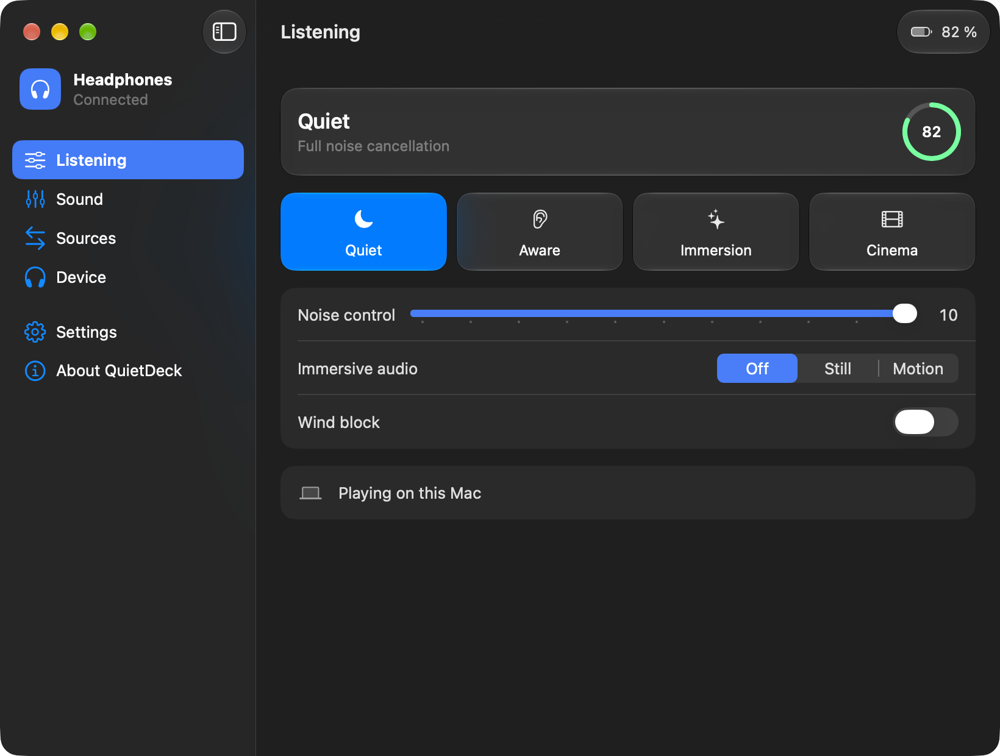
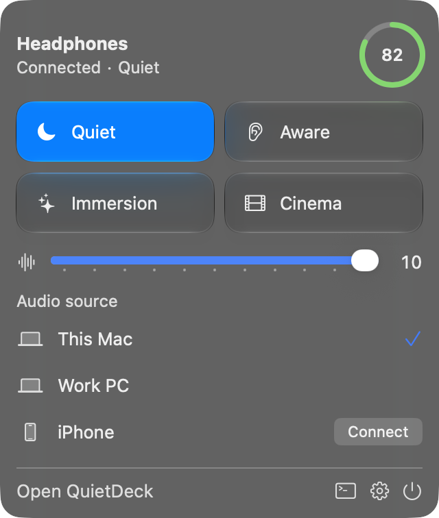
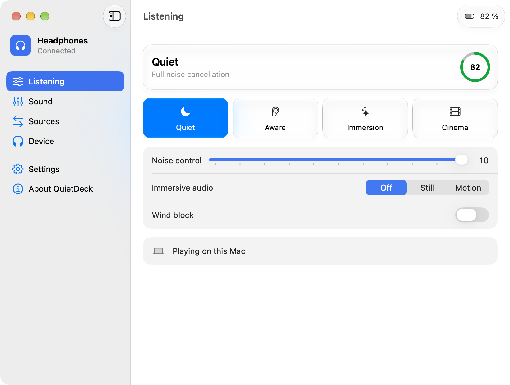
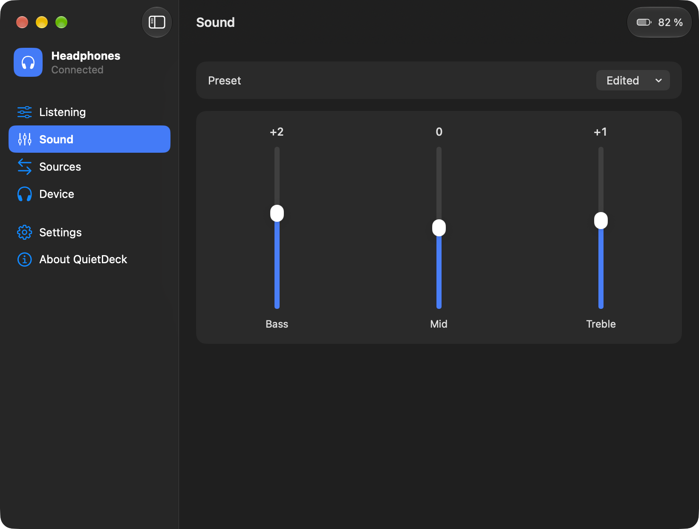
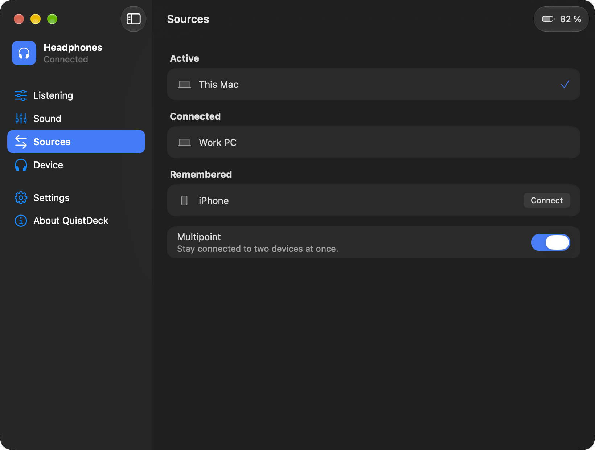
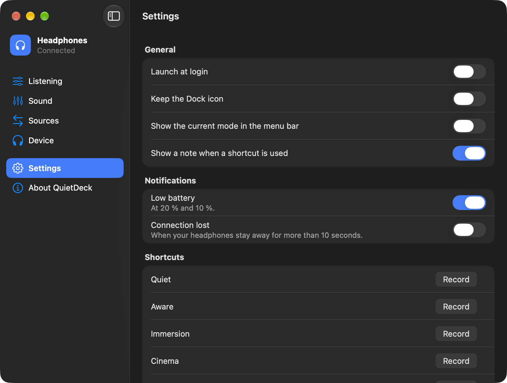
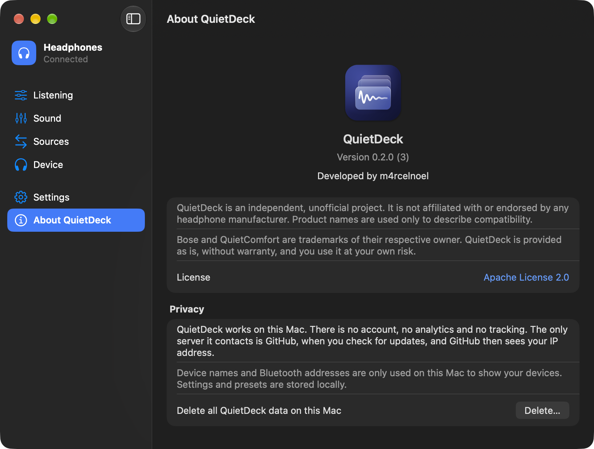

# QuietDeck

Control your headphones from the Mac menu bar, without the manufacturer's app.

QuietDeck is a native macOS app that talks to headphones directly over Bluetooth. Switch listening modes, tune the equalizer, and move audio between your devices. Everything runs on your Mac: no account, no cloud and no tracking.

The first supported device is the Bose QuietComfort Ultra Headphones (2nd Gen). The architecture is vendor-neutral, so other brands can be added as separate driver modules.

> QuietDeck is an independent, unofficial project by m4rcelnoel. It is not affiliated with, endorsed by or sponsored by Bose Corporation or any other headphone manufacturer. Bose and QuietComfort are trademarks of their respective owner, and product names are used only to describe compatibility.

<p align="center">
  
</p>

## Features

- **Listening modes:** Quiet, Aware, Immersion and Cinema, from the menu bar or a global shortcut
- **Sound:** noise control, immersive audio, wind block and a 3-band equalizer with your own presets
- **Two computers on one headset:** connect remembered devices, including a Windows PC, and bring audio to your Mac with one click
- **At a glance:** battery level, active audio source and connection status
- **Notifications:** low battery and lost connection
- **Updates:** installs new versions from within the app, with automatic checks off until you turn them on
- **Native:** Liquid Glass on macOS 26, light and dark mode, English and German, VoiceOver labels

## Screenshots

| Menu bar panel | Light mode |
|---|---|
|  |  |

| Sound | Sources |
|---|---|
|  |  |

| Settings | About and privacy |
|---|---|
|  |  |

## Requirements

- macOS 14 or later
- Headphones paired with the Mac in System Settings

## Documentation

| Guide | For |
|---|---|
| [User guide](docs/user-guide.md) | Installing and using QuietDeck |
| [Privacy](docs/privacy.md) | What happens with your data |
| [Legal notes](docs/legal.md) | License, warranty and trademarks |
| [Contributing](CONTRIBUTING.md) | Branches, CI and pull requests |
| [Adding a driver](docs/adding-a-driver.md) | Supporting another brand |
| [Releasing](docs/release.md) | Signing and notarizing |
| [Bose protocol notes](docs/protocol/bose-bmap.md) | What was verified on hardware |

## Building

You need Xcode 26 or later.

```sh
scripts/test.sh
scripts/lint.sh
```

Or open `QuietDeck.xcodeproj` and run the `QuietDeck` scheme. Debug builds use the bundle ID `com.buddster.quietdeck.debug` and are signed ad hoc, so macOS asks for Bluetooth access again after each build.

## Structure

| Path | Purpose |
|---|---|
| `App/` | SwiftUI app |
| `Packages/QuietDeckCore` | Capability model, driver interface, registry, device controller |
| `Packages/BluetoothTransport` | IOBluetooth RFCOMM bridge and session handling |
| `Packages/BoseDriver` | BMAP frame codec and device driver |
| `Packages/HandoffKit` | Taking over audio output |
| `Packages/QuietDeckTesting` | Mock driver, mock transport and fixtures |

## Protocol references

QuietDeck is an independent implementation. These projects were used as references for protocol behavior only, and no code was copied:

- [N1et/bose-qc-gui](https://github.com/N1et/bose-qc-gui)
- [aaronsb/bosectl](https://github.com/aaronsb/bosectl)
- [MadEyez/quietrebellion](https://github.com/MadEyez/quietrebellion)
- [Denton-L/based-connect](https://github.com/Denton-L/based-connect)

QuietDeck does not bypass, emulate or extract any manufacturer authentication mechanism or keys.

## License

QuietDeck is licensed under the [Apache License 2.0](LICENSE). It's provided as is, without warranty of any kind, and you use it at your own risk. See the [legal notes](docs/legal.md).
