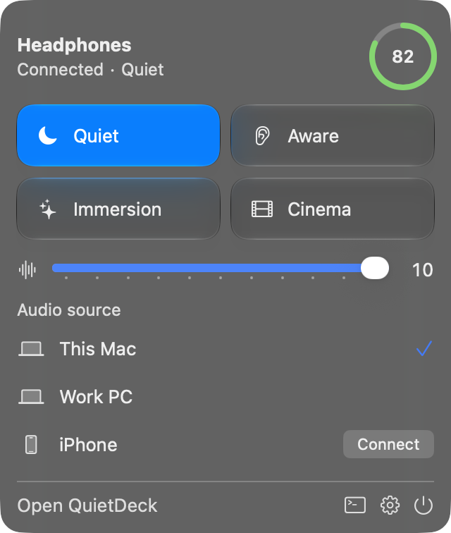
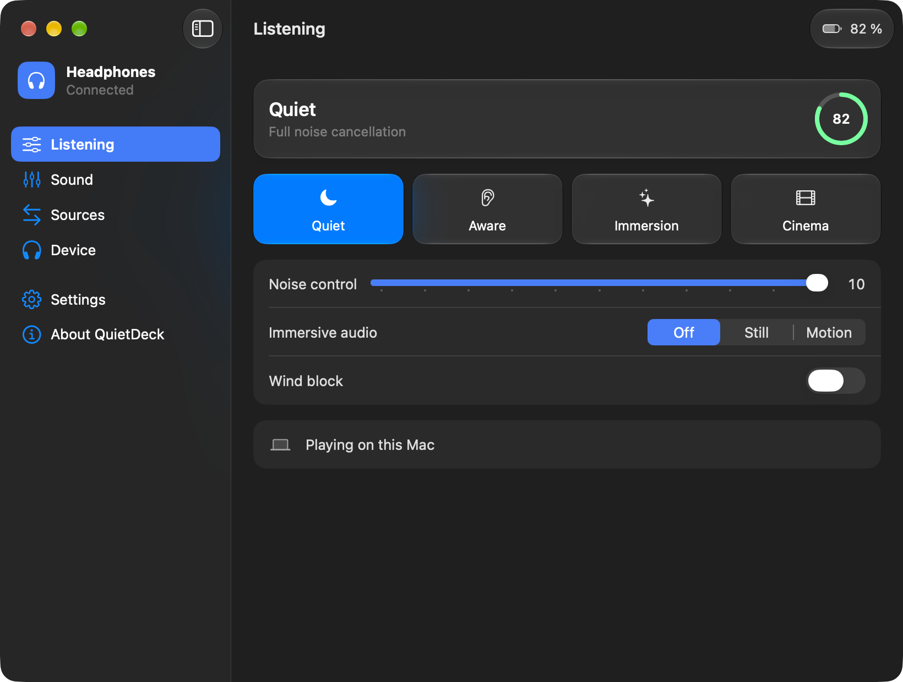
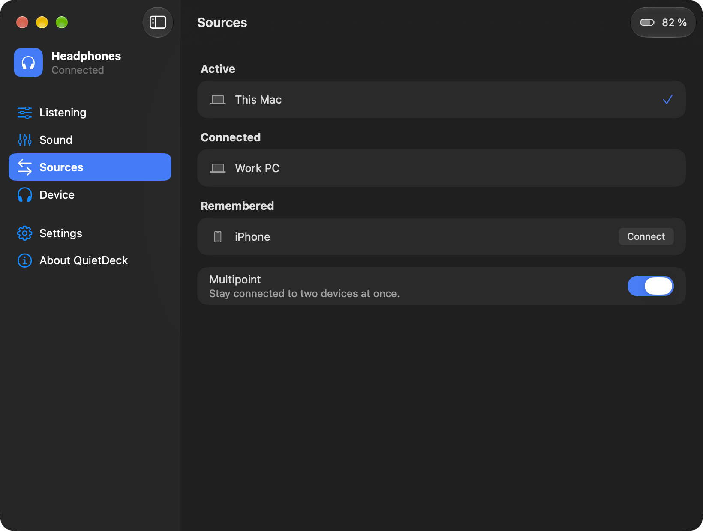

# User guide

## Installing

1. Pair your headphones with your Mac in System Settings > Bluetooth.
2. Open the QuietDeck disk image and drag QuietDeck to Applications.
3. Start QuietDeck and follow the welcome steps. Allow Bluetooth when your Mac asks.

QuietDeck lives in the menu bar. It appears in the Dock only while its window is open. The official headphone app can't use the headphones at the same time, because both need the same connection.

## Menu bar panel

Click the headphones icon at the top of your screen to change the mode, adjust noise control and see your audio sources. The gear opens Settings, and Open QuietDeck opens the main window.

## Main window

| Page | What it does |
|---|---|
| Listening | Modes, noise control, immersive audio and wind block |
| Sound | Equalizer and presets |
| Sources | Devices connected to your headphones |
| Device | Battery, firmware and connection |
| Settings | Launch at login, Dock icon, notifications and shortcuts |
| About QuietDeck | Version, privacy and deleting your data |

Choosing a mode applies its settings. If you change noise control or immersive audio yourself, the mode shows as Custom.

Wind block masks noise control, so the noise level has no audible effect while it's on.

## Using two computers

Your headphones hold two connections, so a Mac and a second computer can stay connected at once.

- **Connect a remembered device:** open Sources and choose Connect. The device needs to be on, with Bluetooth turned on. If two devices are already connected, one is dropped, and QuietDeck tells you which.
- **Move audio to the other device:** start playing there. Your headphones switch by themselves if this Mac is silent.
- **Move audio to this Mac:** choose Bring audio here. QuietDeck pauses the other device and takes over in about 2 seconds.

A device that is playing keeps the headphones, so a second device only takes over once the first one stops.

## Changes made on the headphones

Your headphones don't report button presses. QuietDeck reads them again every 30 seconds and whenever you open the panel, so a change can take a moment to appear.

## Shortcuts

Set global shortcuts in Settings for each mode, for the next mode and for bringing audio here. A shortcut needs Command, Control or Option.

## Updates

Choose QuietDeck > Check for Updates, or open Settings > Updates. The app downloads and installs a new version and restarts. It checks on its own only if you turn on automatic checks. Version 0.1 can't update itself, so install 0.2 from the disk image once.

## If something doesn't work

| Problem | Try this |
|---|---|
| Couldn't connect | Check that the headphones are on, and close the official app on all your devices |
| Remembered device won't connect | Turn it on, wake it, and check its Bluetooth |
| Bring audio here fails | Check that the headphones are your Mac's sound output |
| No notifications | Allow them in System Settings > Notifications |
